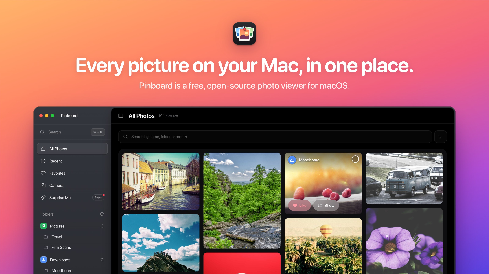
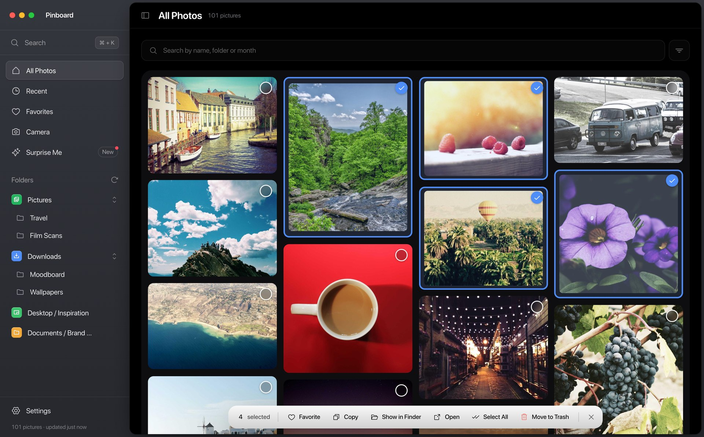
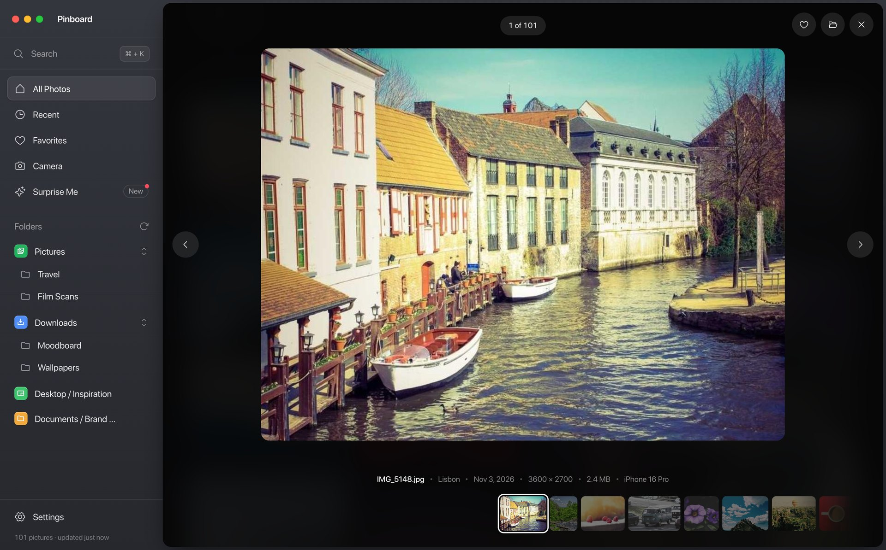
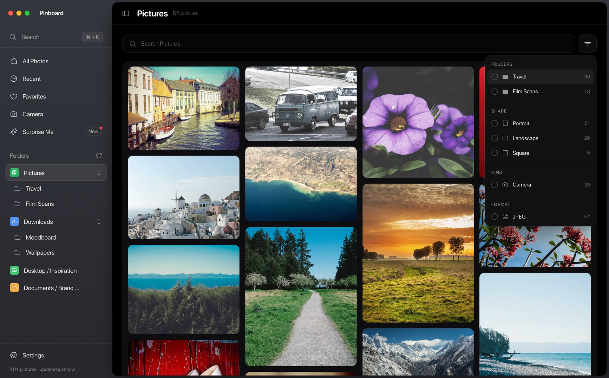

<p align="center">
  
</p>

<h1 align="center">Pinboard</h1>

<p align="center">
  Every picture on your Mac, in one place.<br />
  A free, open-source photo viewer for macOS.
</p>

<p align="center">
  <a href="https://github.com/evildeerxyz/pinboard/releases/latest"><b>Download for Mac</b></a>
  &nbsp;·&nbsp;
  <a href="#install-on-your-mac">Install guide</a>
  &nbsp;·&nbsp;
  <a href="#build-from-source">Build from source</a>
</p>



Pinboard finds the photos, screenshots and saved images spread across your home folder and lays them out on one board you can browse, search and tidy. There's no import and no library to manage: your files stay where they are, and nothing you look at leaves your Mac.

## What it does

- **Finds everything in about two seconds.** Pinboard asks Spotlight for every image in your home folder. It doesn't crawl the disk or copy anything.
- **Leaves out what isn't a picture of yours.** Code projects (any folder with a `package.json`, `.git`, `Cargo.toml` and so on), app caches, icons and other tiny images stay out. You can turn this off in Settings.
- **Sorts by where things live.** Your folders sit in the sidebar, nested the way they are in Finder, next to Recent, Favorites, Screenshots, Camera and Surprise Me.
- **Search with ⌘K.** Jump to any folder or photo by its name, its folder or a month like "october".
- **Filter from one button.** Narrow any view by shape, kind, format or the folders inside it. Tick as many as you like.
- **A viewer with a filmstrip.** Photos open inside the window, with the ones around them along the bottom. Arrow keys move, Escape closes.
- **Opens pictures from Finder.** Double-click a photo and it opens in Pinboard, among the others in its folder, instead of in Preview.
- **Tidy up in bulk.** Select photos with ⌘-click or Shift-click, then Favorite, Copy, Show in Finder, Open or Move to Trash from the bar at the bottom. Moving to the Trash can be undone.
- **Settings for the details:** card size, viewer quality, hidden folders, and how often it looks for new pictures.

<table>
  <tr>
    <td></td>
    <td></td>
  </tr>
  <tr>
    <td align="center">Select photos and act on them together</td>
    <td align="center">The viewer and its filmstrip</td>
  </tr>
  <tr>
    <td></td>
    <td valign="middle" align="center">The Filter menu: folders, shape, kind and format</td>
  </tr>
</table>

## Install on your Mac

You need macOS 13 Ventura or later, on Apple silicon or Intel.

1. Download the DMG (`Pinboard-<version>.dmg`) from the [latest release](https://github.com/evildeerxyz/pinboard/releases/latest).
2. Open the DMG and drag **Pinboard** into **Applications**.
3. Open Pinboard from your Applications folder.

### The first time you open it

Pinboard isn't notarized by Apple yet, so the first time you open it macOS stops it with a message like "Apple could not verify Pinboard is free of malware". That happens to any app from outside the App Store that isn't signed with a paid Apple Developer ID. To open it:

1. Click **Done** in the message. Don't move it to the Trash.
2. Open **System Settings** and go to **Privacy & Security**.
3. Scroll down to **Security**, where it says Pinboard was blocked, and click **Open Anyway**.
4. Click **Open Anyway** again and enter your Mac password if it asks.

You only do this once. If you'd rather use Terminal, or macOS says the app "is damaged", this does the same thing:

```sh
xattr -dr com.apple.quarantine /Applications/Pinboard.app
```

If you want to check the code first, you can [build it yourself](#build-from-source). It's the same app.

### Let it see your folders

macOS asks before any app looks in Downloads, Desktop or Documents. When Pinboard first starts it asks for each one: click **Allow** to include their pictures.

If you clicked Don't Allow, turn Pinboard on in **System Settings › Privacy & Security › Files and Folders**. Then click the refresh button next to Folders in Pinboard's sidebar.

Pinboard finds pictures through Spotlight, so folders you've hidden from Spotlight (System Settings › Spotlight › Search Privacy) don't show up in Pinboard either.

### Open pictures from Finder in Pinboard

Turn on **Settings › Open pictures from Finder in Pinboard**. From then on, double-clicking a JPEG, PNG, HEIC, WebP, GIF or TIFF in Finder opens it in Pinboard. Turn it off to go back to Preview.

For one picture at a time, right-click it in Finder and choose **Open With › Pinboard**. Or, to choose for one kind of file yourself, select a picture, press ⌘I, pick Pinboard under **Open with**, and click **Change All**.

### Update

Download the newer DMG and drag Pinboard into Applications again, choosing **Replace**. Your favorites and settings stay. macOS may ask again for access to Downloads, Desktop and Documents, because the app isn't signed with a Developer ID yet: click **Allow**.

### Uninstall

Quit Pinboard and drag it from Applications to the Trash. To remove its thumbnails, settings and favorites as well, delete these two folders:

```
~/Library/Caches/app.pinboard.photos
~/Library/WebKit/app.pinboard.photos
```

## Build from source

You need the Xcode Command Line Tools (`xcode-select --install`), [Rust](https://rustup.rs) and [Node.js](https://nodejs.org) 22 or later.

```sh
git clone https://github.com/evildeerxyz/pinboard.git
cd pinboard
npm install
npm run dev     # opens Pinboard with live reload
npm run build   # makes src-tauri/target/release/bundle/macos/Pinboard.app
```

Copy `Pinboard.app` into Applications. An app you build yourself opens straight away, with no Gatekeeper step.

To build one app that runs on both Apple silicon and Intel, the way releases are made:

```sh
rustup target add aarch64-apple-darwin x86_64-apple-darwin
npm run release   # makes src-tauri/target/universal-apple-darwin/release/bundle/macos/Pinboard.app
```

## Keyboard shortcuts

| Keys | What it does |
| --- | --- |
| ⌘K | Search photos and folders |
| ⌘F | Search the photos on screen |
| ⌘\ | Show or hide the sidebar |
| ⌘, | Settings |
| ⌘-click, Shift-click | Select photos |
| ⌘A | Select every photo on screen |
| ⌘⌫ | Move the selected photos to the Trash |
| Esc | Clear the selection, or close the viewer |
| ← → | Previous and next photo in the viewer |

## Privacy

Pinboard has no account and no analytics, and it makes no network requests. It gets the list of pictures from Spotlight on your Mac, and makes small thumbnails as photos scroll into view, kept in `~/Library/Caches/app.pinboard.photos`. It only changes your files when you move something to the Trash, and you can put that back. See [SECURITY.md](SECURITY.md) for how it keeps the window from reaching anything else, and how to report a problem.

## How it's built

- [Tauri 2](https://tauri.app) with a Rust backend, and a React interface built with [basedraft UI](https://www.npmjs.com/package/@basedraft/ui).
- **Index:** one `mdfind` query over the home folder. Code projects are spotted by their project files.
- **Thumbnails:** made by Quick Look, in macOS's own sandboxed thumbnail service, so no picture is ever decoded inside Pinboard. Served to the window through a custom protocol, and cached by size and modification time.
- **Trash:** `NSFileManager`'s `trashItemAtURL`, the same as Finder, so Put Back works.

**Tests:** `cargo test` in `src-tauri` covers the index and thumbnails. `cargo test trash_and_put_back -- --ignored` moves a throwaway file to your Trash and back. `node scripts/check.mjs` clicks through the interface in headless Chrome, against a library dump and with Vite running (`npm run vite:dev`). `cargo test --release harness -- --ignored` writes that dump from your own Mac to `pinboard-harness` in your private temporary folder (`$TMPDIR`).

## Credits

The photos in the screenshots are from [Unsplash](https://unsplash.com), via [Lorem Picsum](https://picsum.photos), used under the Unsplash License.

## License

[MIT](LICENSE)
